# Application Atlas

**Network-first application dependency mapping for Splunk:** see which systems talk, over which path, and what breaks when a device fails, built from Cisco, VMware and Kubernetes data you already collect.

> The feature screenshots use synthetic data. See [Verified on a live lab](#verified-on-a-live-lab) for real data.

## What you can do

**1. Trace a packet from source to destination.** Hop by hop across VMware VDS, UCS fabric interconnects, ACI leaves and spines, with each hop marked observed or inferred.

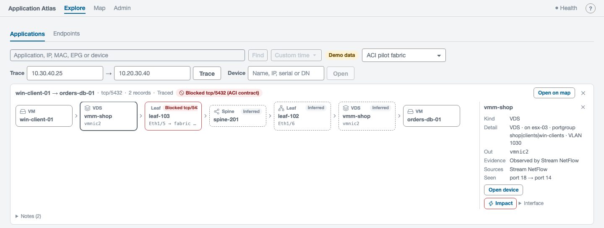

**2. See everything through a device.** Every conversation crossing a leaf, host or switch, with In/Out interfaces and inferred leaf egress.

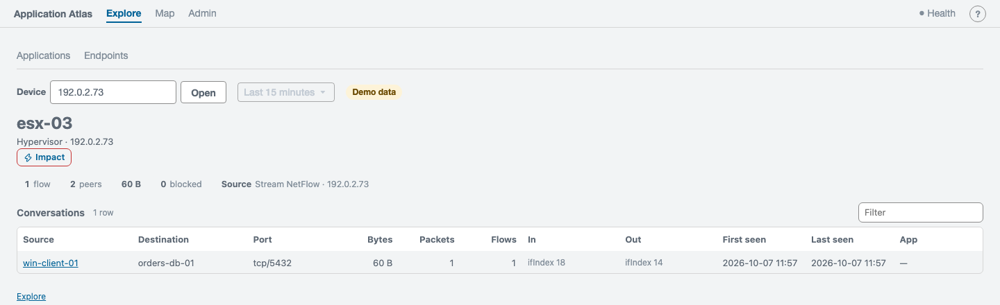

**3. Find what an application depends on.** A decluttered map: bundled lines per card pair, inferred links dashed, blocked conversations in red.

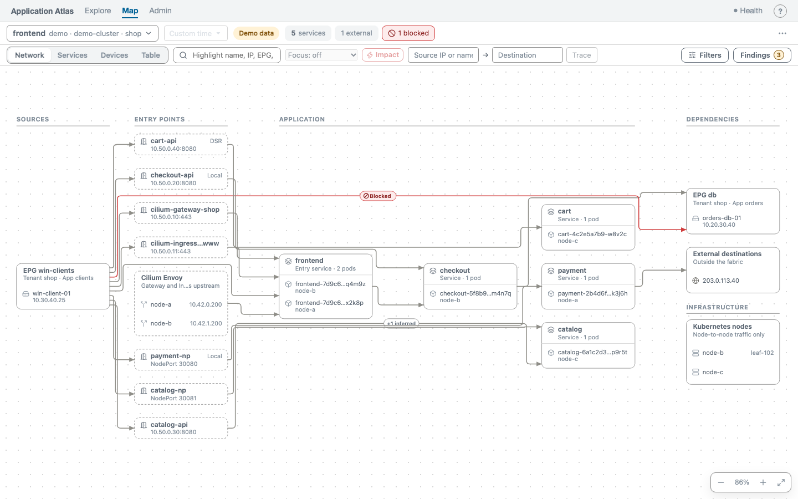

**4. Troubleshoot a blocked flow.** Pinpoint where it was dropped and why: ACI contract (ACL log, live-validated) or Kubernetes policy (Hubble drop; lab-tested only).

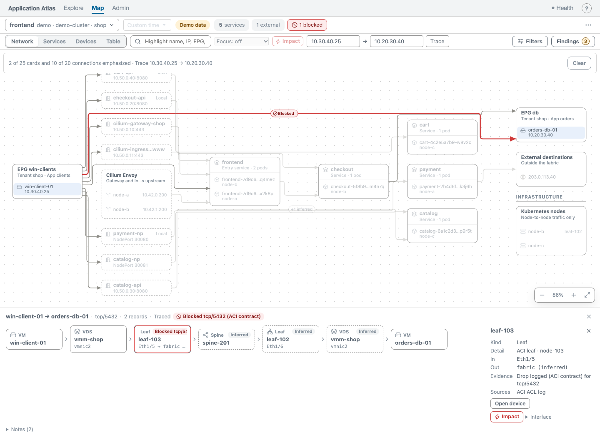

**5. Know the blast radius.** Redundancy-aware impact: **Outage** for single-homed paths, **Degraded** when a vPC peer or replica takes over. Combine elements for what-if.

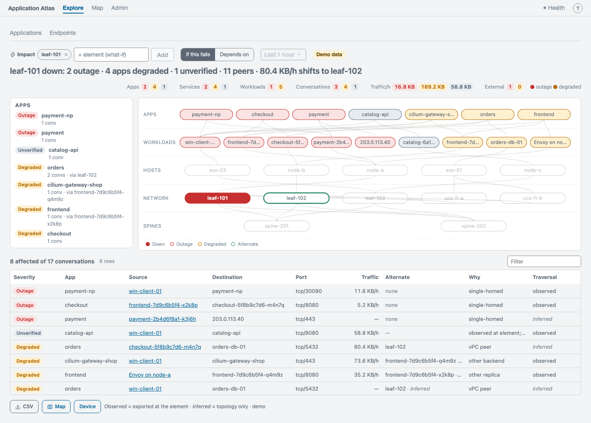

**6. Work at scale.** Exact totals from 15 min to 7 days via 5-minute summaries; maps up to 4,000 nodes / 10,000 edges with ranked top-N; devices grouped by kind.

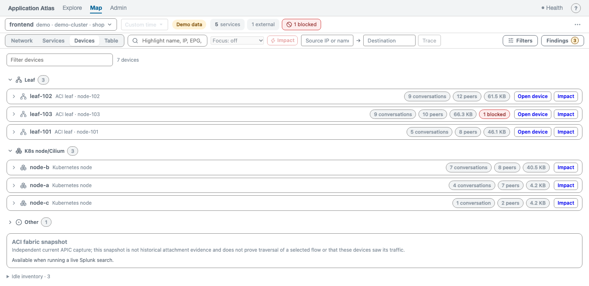

See [browser performance and scale](docs/BROWSER_PERFORMANCE.md) for measured timings.

**7. Investigate IPv4 multicast.** Open **Multicast**, select a routing scope and time window, and see every group observed there. **Overview** lists each group's senders, receiver interest and flow evidence, with flags for evidence gaps such as interest with no sender seen. **Compare with previous window** marks groups that are new since the previous window.

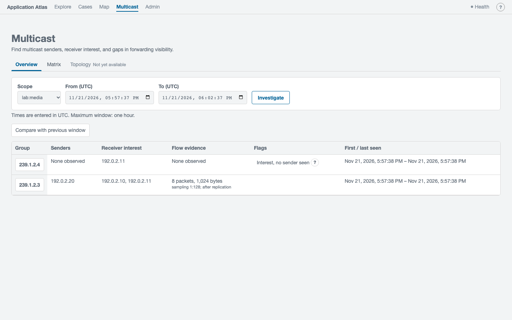

**Matrix** shows the same results as a grid of groups by IGMP segment and NetFlow exporter.

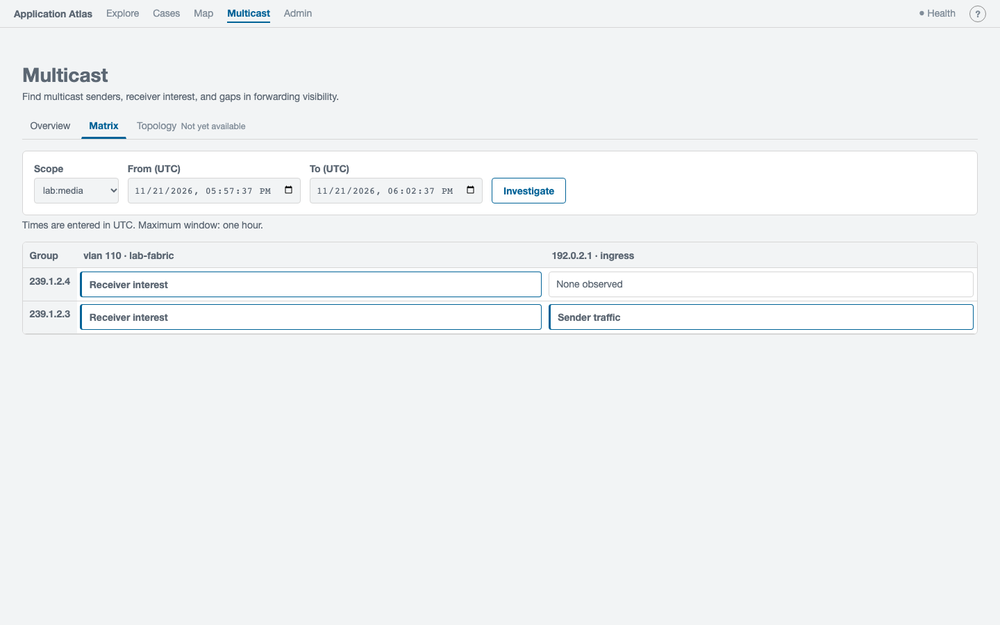

Select a group to see which senders were observed, which segments reported IGMP interest, an IGMP timeline, and where forwarding visibility ends. Select an observation to inspect its source, capture point, and limits.

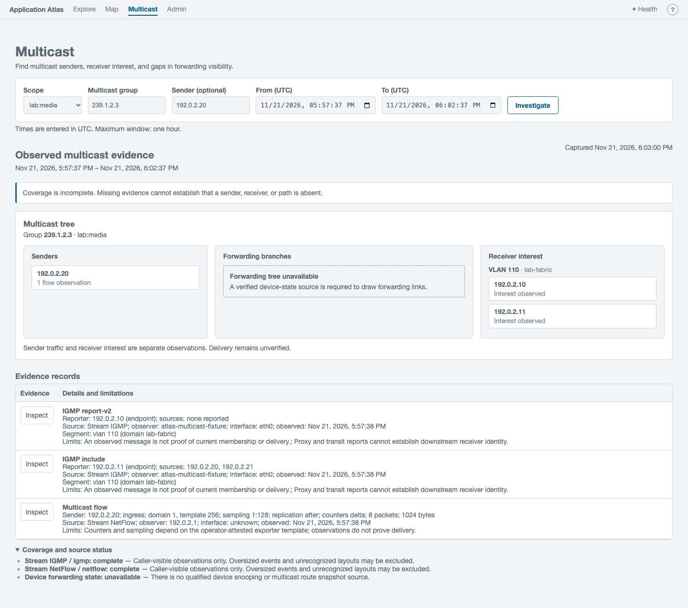

**Follow the forwarding tree.** This sanitized replay preserves the shape of a verified NX-OS VXLAN underlay tree. Atlas shows four device-supported links across two spine paths and marks both leaf `nve1` next hops as unresolved. The snapshot shows forwarding state at one point in time. Packet delivery and receiver membership require separate evidence.

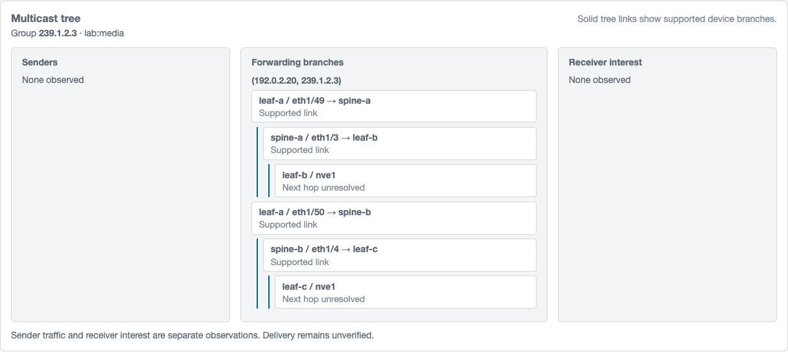

The setup screen appears when no multicast profiles are active. See the [Multicast operator guide](docs/operators/multicast.md) for capture placement, source verification, and enablement.

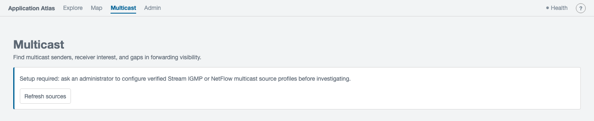

**8. Analyze network and application protocols.** Open **Protocols** for a unified hub linking standalone **Multicast / IGMP** alongside 13 scoped, on-demand protocol workbenches (**TCP Health & TLS**, **DNS Operations**, **Routing Control Plane**, **L2 Control Plane**, **Interface & Link Health**, **QoS/DSCP & ICMP**, **Enterprise L7**, **Blocked Traffic & Drops**, **Endpoint Mobility & ARP**, **HTTP & DB Transactions**, **State-Change Timeline**, **Management-Plane Hygiene**, and **Load Balancer Pool Health**) plus an on-demand **Traffic & IP mix** strip. Zero searches run on page load, and every lens enforces strict field allowlists (never projecting `_raw`, SQL query text, cookies, SNMP communities, or credentials).

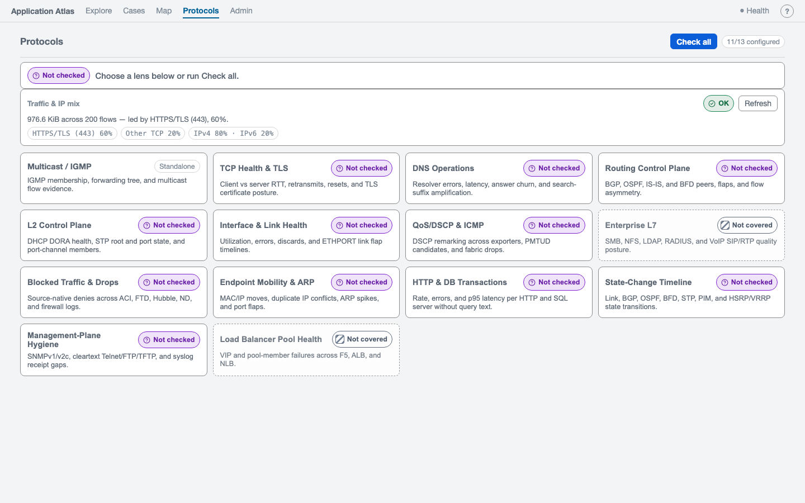

Every lens provides a URL-synced SPL filter bar (`Source IP`, `Dest IP`, `Port`, `A↔B` bidirectional toggle, `Device` / `Interface` / `VNI`), instant client-side table search, selectable UTC window presets (`15m`, `30m`, `60m`), and one-click **Focus flow** / **Focus** pivots from the detail drawer so operators can isolate a single conversation below row caps.

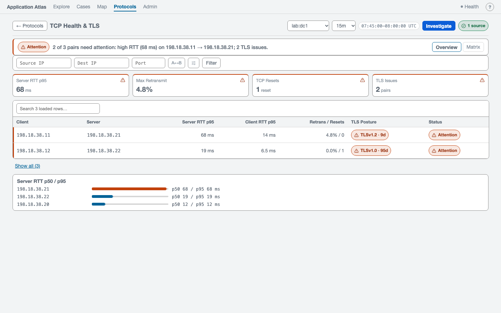

Switch any lens to **Matrix** to pivot across `Client × Server`, `Device × Peer`, or `Device × Interface` grids (with peer adjacency overlays on **Routing Control Plane**), marking unobserved cells as **None observed** when complete and **Unknown** when capped. See [Protocol analysis workbenches](docs/operators/README.md#protocol-analysis-workbenches) for per-lens operator guides.

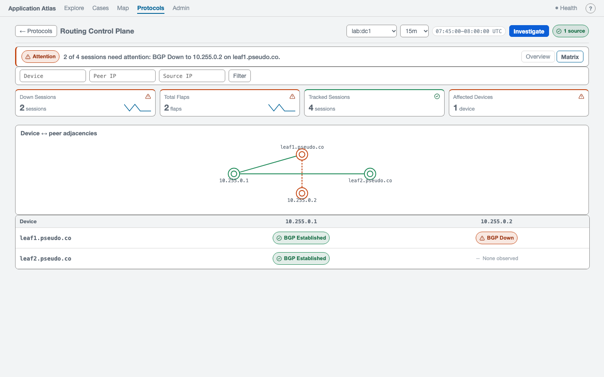

## Verified on a live lab

Splunk Cloud 10.6 + ACI 6.1 + vSphere VDS + UCS fabric interconnects + Kubernetes, November 2026.

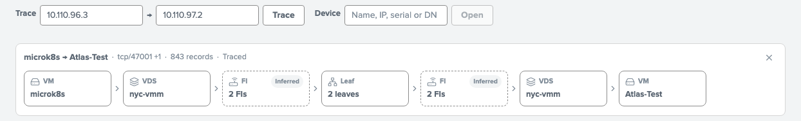

- [Live lab click-through scenarios](docs/demos/LIVE_LAB_SCENARIOS.md): trace, L3Out, contract deny, vPC failover, pod reschedule, impact, collector gap.
- [Live change scenarios and findings](docs/operators/LIVE_SCENARIOS.md).

## Data sources

Splunk is required; add sources for the questions you need answered. Full matrix, versions and indexes: [operator guides](docs/operators/README.md).

| Source | What it adds |
| --- | --- |
| [Splunk Enterprise 10.6.0.5 / Cloud](docs/operators/splunk-platform.md) ([support matrix](docs/operators/SUPPORT_MATRIX.md)) | Search, summaries, correlation and the Atlas UI |
| [Splunk Stream NetFlow/IPFIX & wire capture](docs/operators/network-stream.md) | Observed conversations, ACI leaf/port "Seen", plus optional wire TCP RTT/TLS (`stream:tcp`), DNS, ICMP, ARP, and HTTP |
| [Stream IPFIX from VMware VDS](docs/operators/network-stream.md#vmware-vds-ipfix) | VDS hop observations on traces and Device pages |
| [Cisco ACI / APIC classes](docs/operators/aci-network.md) | Endpoints, EPG/BD, fabric links, contracts, ACL-log drops, vPC, L3Out |
| [ACI VMM / adjacency classes](docs/operators/ACI_VMM_ADJACENCY_CLASSES.md) | ESXi hosts, VDS ports, host uplinks, UCS FI hop (via LLDP) |
| [Splunk Add-on for VMware](docs/operators/INTERSIGHT_VMWARE_LAB_SETUP.md) | VDS port and host uplink (vmnic) names |
| SC4S / SC4SNMP | HEC-backed switch/firewall syslog (`cisco:ios`, `cisco:aci`) and IF-MIB interface names for NetFlow ifIndex values |
| [Cisco Intersight](docs/operators/INTERSIGHT_VMWARE_LAB_SETUP.md) | Not read yet; FI hop currently comes from APIC LLDP |
| [Nexus Dashboard / NX-OS](docs/operators/aci-network.md#nexus-dashboard-inputs) | Fabric flows, endpoint history, device and interface context |
| [Kubernetes + Splunk OTel Collector](docs/operators/kubernetes-platform.md) | Pod, Service and node identity history; service calls |
| [Cilium / Hubble](docs/operators/cilium-isovalent.md) | Pod flows, Service-to-backend handoff, policy drops |
| [Cisco FMC / FTD](docs/operators/firewall-security.md) | Firewall observations and NAT |
| Optional | [AppDynamics](docs/operators/appdynamics-evidence.md), [ThousandEyes](docs/operators/thousandeyes.md), [Catalyst Center / Meraki](docs/operators/cisco-enterprise-networking.md), [DNS](docs/operators/dns-evidence.md), [Observability Cloud](docs/operators/o11y-health.md) |

Observed traffic and inferred topology are always labeled separately; missing data stays unresolved.

## Get started

**Demo locally** (Node 22.13+ within 22.x, 24.x or 26+; no Splunk needed):

```sh
git clone --recurse-submodules https://github.com/chambear2809/splunk-adm.git
cd splunk-adm
npm ci --registry=https://registry.npmjs.org --ignore-scripts
npm run dev
```

Presenter scripts: [networking SE](docs/demos/NETWORKING_SE.md) · [Splunk SE](docs/demos/SPLUNK_SE.md) · [presenter guide](docs/demos/README.md).

**Use your data:** follow the [Splunk setup guide](docs/operators/splunk-setup-guide.md). Pinned setup automation for Claude Code, Cursor and Codex lives in `vendor/splunk-cisco-skills` ([instructions](AGENTS.md#operator-setup-skills)).

**Develop and package:** `npm run lint`, `npm test`, `npm run package` (output in `dist/`). See [build and lab requirements](docs/PILOT.md) and [CI](docs/CI.md).

## Project status

| Area | Status |
| --- | --- |
| Splunk Enterprise 10.6.0.5 | Lab-qualified with synthetic data (standalone, V2 migration, bounded SHC) |
| Splunk Cloud 10.6 | Live lab validation of read-only views, 2026-11; Setup writes, Cases, Baselines and recovery refuse Cloud |
| Production capacity, customer pilots, Splunk Cloud app vetting | Not yet qualified |

Details: [support matrix by feature and platform](docs/operators/SUPPORT_MATRIX.md) · [qualification evidence and limits](docs/ATLAS_FINAL_QUALIFICATION.md) · [optional integrations](docs/OPTIONAL_INTEGRATIONS_QUALIFICATION.md).

**Upgrading?** Atlas now restricts app and derived-lookup read access to the `adm_viewer` role. Existing non-admin users lose access until an administrator grants it; see [Upgrades](docs/UPGRADES.md#action-required-atlas-viewer-role).

## Links

[Data layer](docs/DATA_LAYER.md) · [Deployment health](docs/DEPLOYMENT_HEALTH.md) · [Upgrades](docs/UPGRADES.md) · [Backup/restore](docs/BACKUP_RESTORE.md) · [Recovery](docs/RECOVERY.md) · [Contributing](AGENTS.md) · [Security](docs/SECURITY.md)

Licensed under [Apache 2.0](LICENSE); see [NOTICE](NOTICE).
