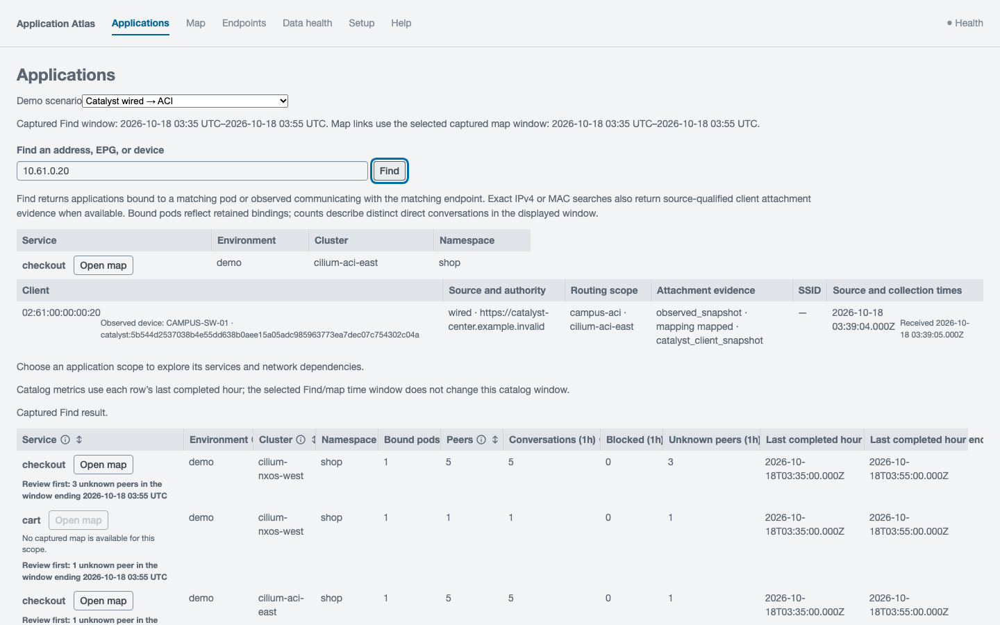
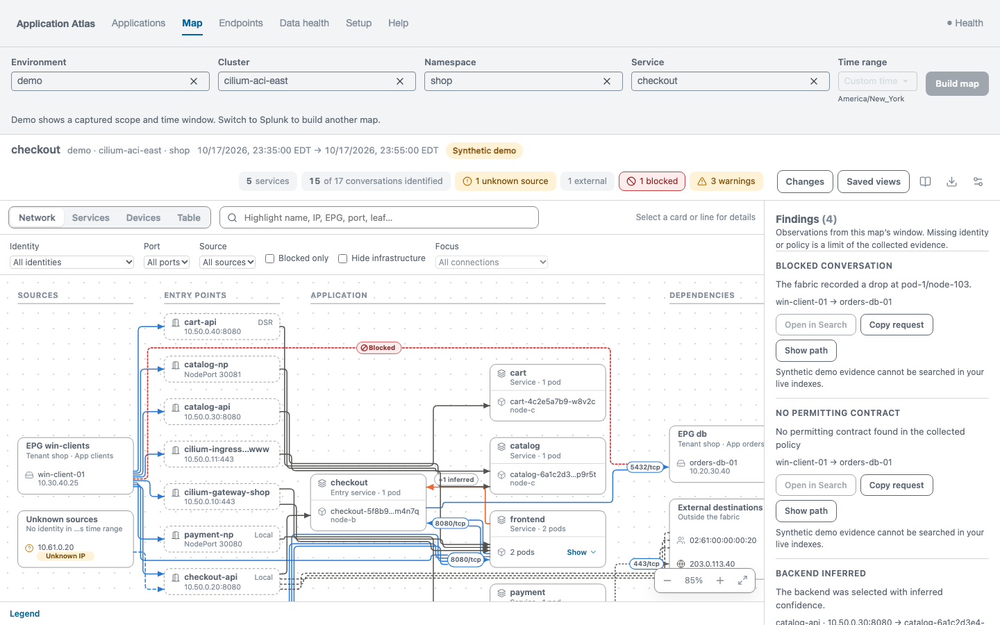
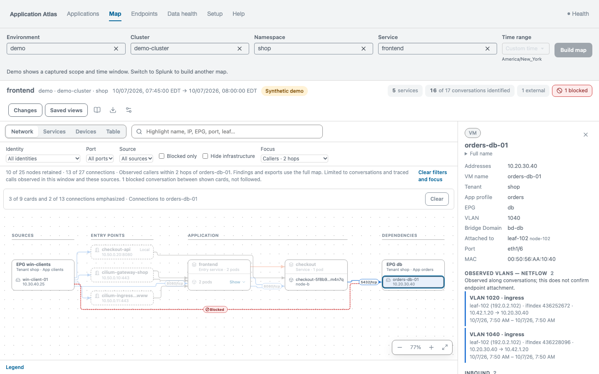

# Application Atlas

**Application dependency mapping in Splunk.** Application Atlas shows how clients, applications and infrastructure communicate. It combines network flows, Kubernetes history, application traces and Cisco infrastructure data into a map of who talks to what, over which ports, and how clients reach an application.

Atlas runs inside Splunk and uses data your teams already collect. Network observations show the connections; workload history identifies the systems behind the IP addresses; traces add service-level context. Together, they help application, network and security teams investigate the same dependency with a shared set of evidence.

## See it work

These screenshots come from the running app with the repository's synthetic demo dataset (hosts, addresses and the `example.invalid` controller are fictional; the app labels demo data "Synthetic demo", though some framings below crop that label).

**Find an application from network evidence.** Searching an address returns the application it was observed reaching, plus source-qualified client attachment evidence. The catalog below sorts scopes with problems first and names the window its counts cover.



**Open its map.** The map shows entry points, services, pods and dependencies, with findings for blocked conversations, unknown sources and warnings.



**Troubleshoot a blocked connection.** Show path on a finding highlights the conversation and lists the candidate fabric path; the strip marks which hops were seen in the logs and which are inferred only.


**Check blast radius.** Select a card and choose Focus, then Callers (observed reaching the selection) or Dependencies (what it was observed reaching), within 1 to 3 hops. Here, Callers within 2 hops of the orders-db-01 database retains 10 of 25 nodes and 13 of 27 connections, as displayed. The summary notes that the focus is limited to conversations and traced calls observed in the window and sources, so it is not a full impact analysis. The one blocked conversation between shown cards is displayed but not followed.



## Why it matters

IP addresses change, workloads move, and dependency evidence is spread across network, platform and application tools. Atlas brings that context together to help teams:

- **Troubleshoot across teams:** connect a client or service to its workloads, external dependencies and traffic observers, reducing manual searches across separate tools.
- **Plan changes:** identify observed dependencies before a migration, network change or segmentation project so teams can review the connections that need to remain available.
- **Review connectivity:** export required flows and inspect available ACI policy context, while seeing which conclusions are supported and where evidence is missing.

The map distinguishes observed traffic from inferred candidate paths. Device inventory can suggest a fabric path, but it does not prove the route a packet took. Missing data stays unresolved; it is never replaced with demo data.

## How it works

1. **Collect into Splunk.** Existing add-ons and collectors ingest flows, controller inventory, Kubernetes objects and spans into source indexes.
2. **Build dependency history.** Scheduled searches normalize traffic into conversations and maintain endpoint, workload and Service history in summary indexes and KV Store. Correlation uses the relevant time and routing scope, so reused IPs in unrelated networks do not become one identity.
3. **Explore an application.** Select an application or use Find, choose a scope and time window, and build the map. Inspect dependencies, ports, observers, candidate paths and supporting evidence, focus on a selected card's callers or dependencies within 1 to 3 hops, or export required flows. Data health explains source freshness and scheduled-search outcomes against the configured expectations.

For example, a client reaches a Kubernetes LoadBalancer address and the application calls a database VM. Flow records establish the observed connections; Kubernetes history identifies the frontend and workloads; compatible Hubble evidence can connect that client's frontend connection to a backend pod. ACI inventory adds the VM's network context, and traces add service calls where instrumented. If the backend evidence is missing or ambiguous, that part stays unresolved.

## Products and what each must provide

**Splunk is required; other products depend on the features you need.** Traffic feeds establish connections, inventory supplies identity and attachment context, and Kubernetes history and traces explain application relationships. Inventory alone does not establish that traffic occurred. The linked guides provide exact fields, supported versions and setup steps.

| Product                                                                            | What it adds                                                                           | Required configuration or data                                                                                                       |
| ---------------------------------------------------------------------------------- | -------------------------------------------------------------------------------------- | ------------------------------------------------------------------------------------------------------------------------------------ |
| [**Optional DNS evidence**](docs/operators/dns-evidence.md) | Scoped endpoint investigations and supplemental resolution context | Customer-managed Stream DNS or Hubble DNS L7; verified source scope, caller access and target qualification. |
| [**Splunk Enterprise**](docs/operators/splunk-platform.md)                         | Search, correlation, history and the Atlas interface                                   | Healthy KV Store; source and summary indexes; index permissions and routing-scope mappings.                                          |
| [**Splunk Stream + NetFlow/IPFIX exporters**](docs/operators/network-stream.md)    | Connections, ports, traffic counters and observing devices                             | Stream add-ons, a receiver and an enabled NetFlow stream; endpoint, time, exporter, interface and sampling fields.                   |
| [**Splunk Observability Cloud — optional**](docs/operators/o11y-health.md) | Indexed historical metric captures and separately selected detector events | External server-side collection, private durable HEC spool, exact authority/detector bindings and target qualification. Event history does not establish historical incident state. |
| [**Splunk AppDynamics — optional**](docs/operators/appdynamics-evidence.md) | Current node/IP inventory and application-scoped backend candidates | Explicit Controller authority, read-only Application Model APIs, completed bounded snapshots and caller-visible indexes. Inventory does not prove calls or historical IP ownership. |
| [**Cisco ThousandEyes — optional**](docs/operators/thousandeyes.md) | Synthetic measurements, measured probe paths, synthetic traces, detected events, alerts and ThousandEyes activity context | Cisco-supported Splunk integration 0.9.0, explicit account/test/agent bindings, caller-visible indexes and qualification of every selected input family. Probe observations do not add passive traffic or prove another connection's route. |
| [**Edge / Ingest Processor templates — optional**](docs/operators/ingest-processors.md) | Conservative Stream NetFlow and Atlas health routing profiles | Product-specific deployment/transport settings and runtime preview qualification. Offline golden fixtures do not execute SPL2. |
| [**Cisco ACI / APIC**](docs/operators/aci-network.md)                              | Endpoint identity, EPG/bridge-domain context, candidate fabric paths and policy intent | DC Networking add-on, read-only APIC access, and endpoint, topology and policy inputs.                                               |
| [**Nexus Dashboard / NX-OS**](docs/operators/aci-network.md)                       | Flow, endpoint, device and interface context                                           | DC Networking add-on; applicable flow/endpoint inputs and device/interface/neighbor collection.                                      |
| [**Kubernetes + Splunk OTel Collector**](docs/operators/kubernetes-platform.md)    | Pod/workload identity and Service/backend history                                      | Cluster identity, RBAC, object watches with initial state, and HEC delivery to Splunk.                                               |
| [**Cilium / Hubble**](docs/operators/cilium-isovalent.md)                          | Pod-level flows and evidence linking Service frontends to backends                     | Hubble JSON-lines flow export, collector file tailing, cluster identity and load-balancing settings.                                 |
| [**Isovalent Runtime Security**](docs/operators/cilium-isovalent.md)               | Process connection evidence                                                            | Cisco Security Cloud add-on, `processConnect` events through HEC, and a source-to-cluster mapping.                                   |
| [**Applications using OpenTelemetry**](docs/operators/application-teams.md)        | Service calls and service-to-workload bindings                                         | OTLP export, service/environment/pod attributes, and CLIENT spans with peer IP, port and timestamps.                                 |
| [**Cisco FMC / FTD**](docs/operators/firewall-security.md)                         | Firewall observations for traffic crossing FTD                                         | Cisco Security Cloud add-on and eStreamer connection events.                                                                         |
| [**Catalyst Center — optional V2**](docs/operators/cisco-enterprise-networking.md) | Wired-client identity and attachment observations                                      | Enterprise Networking add-on, scoped client API access and explicit source profiles.                                                 |
| [**Meraki — optional V2**](docs/operators/cisco-enterprise-networking.md)          | Wireless-client attachment context                                                     | Meraki add-on, association events, compatible flow evidence and source profiles. NetFlow alone cannot establish wireless attachment. |

Choose sources by the question you want to answer:

- **Which systems communicate?** Start with a supported traffic feed and explicit routing-scope mappings. Without workload evidence, endpoints may remain IP addresses. Find needs service/workload bindings to open an application map. The separate **Endpoints** page supports scoped-IP investigations from configured conversation summaries and verified scope, without requiring a Kubernetes or trace catalog; optional DNS adds resolution context.
- **Which Kubernetes workload served a client?** Add object history and compatible Hubble handoff evidence. Traces add service calls and bindings; they are optional for network-derived conversations.
- **What network or client context applies?** Add ACI/Nexus inventory for fabric context, FTD for firewall observations, or qualified Catalyst/Meraki V2 enrichment for client attachment.

HEC is Splunk's HTTP Event Collector; OTLP is the OpenTelemetry export protocol. RBAC grants the collector permission to read Kubernetes objects. Optional SD-WAN IPFIX retains overlay references, not router/tunnel topology. Verify exact product versions and compatibility in the guides.

## Get started

**Try the demo:** use Node 22.13+ within 22.x, 24.x or 26+, and npm.

```sh
git clone --recurse-submodules https://github.com/chambear2809/splunk-adm.git
cd splunk-adm
npm ci --registry=https://registry.npmjs.org --ignore-scripts
npm run dev
```

Open the localhost URL; the captured synthetic demos need no Splunk connection.

**Present the demo:** follow the [networking SE script](docs/demos/NETWORKING_SE.md) or [Splunk SE script](docs/demos/SPLUNK_SE.md). Both include timed talk tracks, exact clicks, expected results and recovery steps. The [presenter guide](docs/demos/README.md) covers local setup and the separate synthetic endpoint/DNS UI segment.

**Use your data:** follow the [operator setup sequence](docs/operators/splunk-setup-guide.md). Atlas reads indexed data; operators configure collectors, indexes, permissions, scopes and deployment expectations. Searches and settings writes ship disabled; settings persistence requires deployment qualification. V2 activation follows the [migration procedure](docs/CISCO_CONTRACT_MIGRATION.md).

**Develop/package:** `npm run lint`, `npm test`, `npm run package` (requires `tar`). The app archive and checksum appear in `dist/`. `npm run package` also produces a separate `application-atlas-integrations-<version>.tar.gz` for optional external collectors and processor templates; it installs no runtime or schedule in Splunk. See [build/lab requirements](docs/PILOT.md) and [CI](docs/CI.md).

## Project status

Recorded qualification covers **Splunk Enterprise 10.6.0.5** with synthetic data: standalone execution, V2 migration and bounded same-host SHC validation. Production capacity/topology, real controller/exporter collection, customer pilots and Splunk Cloud runtime/vetting remain unqualified. SHC validation does not authorize V2 cutover there. See [qualification evidence and limits](docs/ATLAS_FINAL_QUALIFICATION.md).

## Optional integrations

The [integration contract](docs/OPTIONAL_INTEGRATIONS_PLAN.md) records source
admission, identity/time rules, delivery semantics and rollback. New integrations
ship unselected and unqualified. Follow each operator guide before selecting a
source; a successful HEC response is separate from indexed evidence validation.
See [current qualification and external limits](docs/OPTIONAL_INTEGRATIONS_QUALIFICATION.md).
The [ThousandEyes design](docs/THOUSANDEYES_DESIGN.md),
[capability matrix](docs/research/thousandeyes-capabilities.md) and
[qualification record](docs/THOUSANDEYES_QUALIFICATION.md) describe its separate
disabled defaults and producer/deployment gates.
The separate [external toolkit guide](docs/OPTIONAL_INTEGRATIONS_TOOLKIT.md)
describes installation, command entry points and safe local state placement.

## Operator setup skills

Pinned automation in `vendor/splunk-cisco-skills` supports Claude Code, Cursor and Codex. Follow [team setup guides](docs/operators/README.md) and [skill/credential instructions](AGENTS.md#operator-setup-skills); MCP mutations ship disabled.

## Further reading

- [Data and correlation contract](docs/DATA_LAYER.md) · [Deployment expectations and health](docs/DEPLOYMENT_HEALTH.md)
- [Upgrades](docs/UPGRADES.md) · [Backup/restore](docs/BACKUP_RESTORE.md) · [Recovery](docs/RECOVERY.md)
- [Contributing](AGENTS.md) · [Security](docs/SECURITY.md)

Licensed under [Apache 2.0](LICENSE); see [NOTICE](NOTICE).
