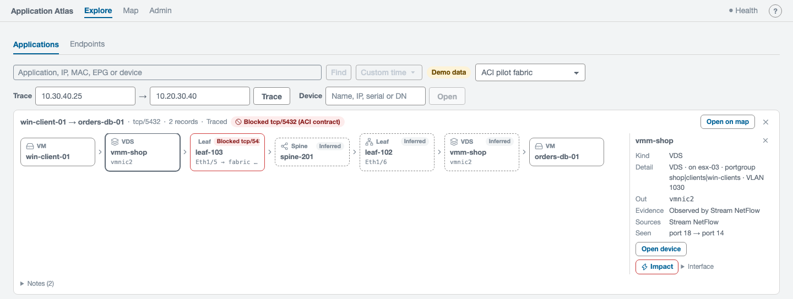
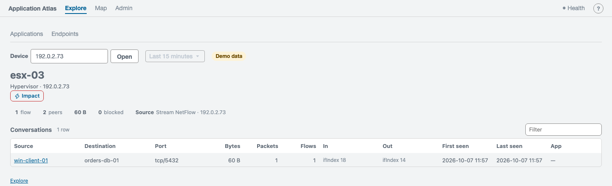
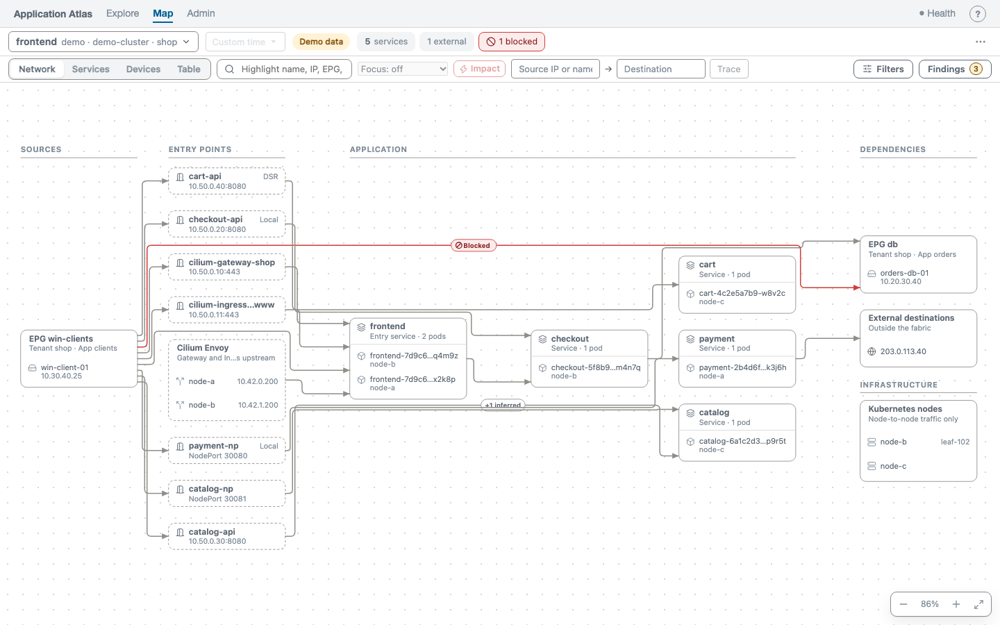
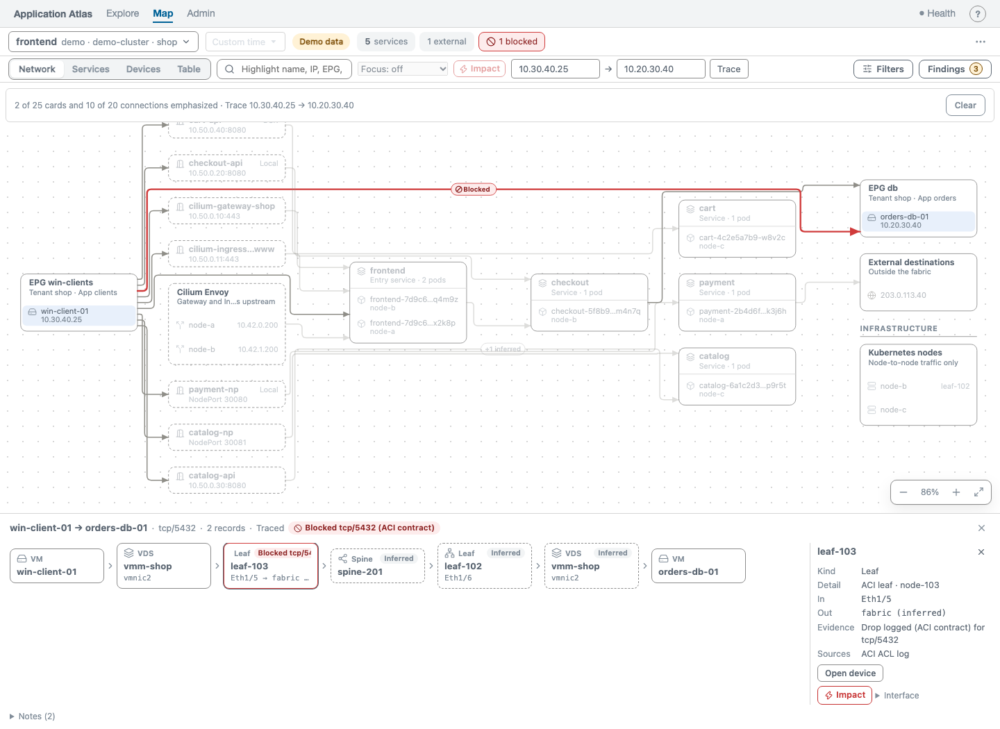
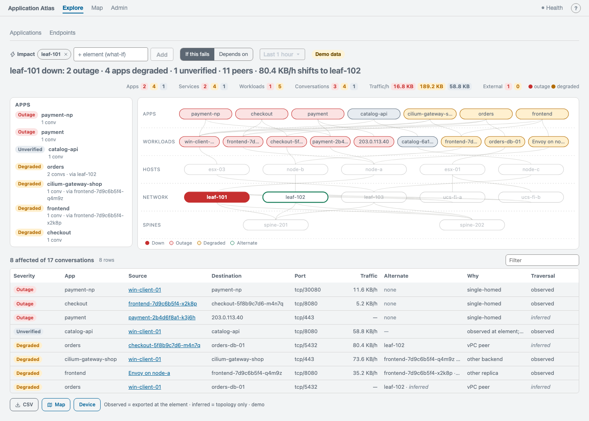
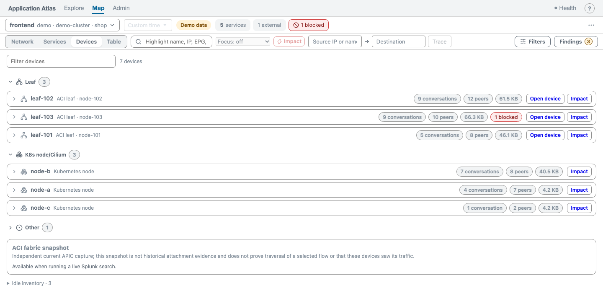
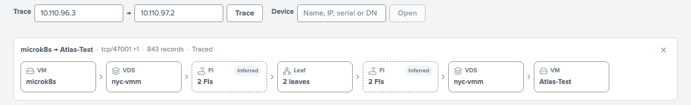

# Application Atlas

**Network-first application dependency mapping for Splunk:** see which systems talk, over which path, and what breaks when a device fails, built from Cisco, VMware and Kubernetes data you already collect.

> Screenshots below use the repository's synthetic demo dataset (labeled **Demo data**). See [Verified on a live lab](#verified-on-a-live-lab) for real data.

## What you can do

**1. Trace a packet from source to destination.** Hop by hop across VMware VDS, UCS fabric interconnects, ACI leaves and spines, with each hop marked observed or inferred.



**2. See everything through a device.** Every conversation crossing a leaf, host or switch, with In/Out interfaces and inferred leaf egress.



**3. Find what an application depends on.** A decluttered map: bundled lines per card pair, inferred links dashed, blocked conversations in red.



**4. Troubleshoot a blocked flow.** Pinpoint where it was dropped and why: ACI contract (ACL log, live-validated) or Kubernetes policy (Hubble drop; lab-tested only).



**5. Know the blast radius.** Redundancy-aware impact: **Outage** for single-homed paths, **Degraded** when a vPC peer or replica takes over. Combine elements for what-if.



**6. Work at scale.** Exact totals from 15 min to 7 days via 5-minute summaries; maps up to 4,000 nodes / 10,000 edges with ranked top-N; devices grouped by kind.



See [browser performance and scale](docs/BROWSER_PERFORMANCE.md) for measured timings.

## Verified on a live lab

Splunk Cloud 10.6 + ACI 6.1 + vSphere VDS + UCS fabric interconnects + Kubernetes, November 2026.



- [Live lab click-through scenarios](docs/demos/LIVE_LAB_SCENARIOS.md): trace, L3Out, contract deny, vPC failover, pod reschedule, impact, collector gap.
- [Live change scenarios and findings](docs/operators/LIVE_SCENARIOS.md).

## Data sources

Splunk is required; add sources for the questions you need answered. Full matrix, versions and indexes: [operator guides](docs/operators/README.md).

| Source | What it adds |
| --- | --- |
| [Splunk Cloud / Enterprise 10.6+](docs/operators/splunk-platform.md) | Search, summaries, correlation and the Atlas UI |
| [Splunk Stream NetFlow/IPFIX](docs/operators/network-stream.md) | Observed conversations; ACI leaf and port "Seen" |
| [Stream IPFIX from VMware VDS](docs/operators/network-stream.md#vmware-vds-ipfix) | VDS hop observations on traces and Device pages |
| [Cisco ACI / APIC classes](docs/operators/aci-network.md) | Endpoints, EPG/BD, fabric links, contracts, ACL-log drops, vPC, L3Out |
| [ACI VMM / adjacency classes](docs/operators/ACI_VMM_ADJACENCY_CLASSES.md) | ESXi hosts, VDS ports, host uplinks, UCS FI hop (via LLDP) |
| [Splunk Add-on for VMware](docs/operators/INTERSIGHT_VMWARE_LAB_SETUP.md) | VDS port and host uplink (vmnic) names |
| SC4SNMP (IF-MIB) | Switch interface names for NetFlow ifIndex values |
| [Cisco Intersight](docs/operators/INTERSIGHT_VMWARE_LAB_SETUP.md) | Not read yet; FI hop currently comes from APIC LLDP |
| [Nexus Dashboard / NX-OS](docs/operators/aci-network.md#nexus-dashboard-inputs) | Fabric flows, endpoint history, device and interface context |
| [Kubernetes + Splunk OTel Collector](docs/operators/kubernetes-platform.md) | Pod, Service and node identity history; service calls |
| [Cilium / Hubble](docs/operators/cilium-isovalent.md) | Pod flows, Service-to-backend handoff, policy drops |
| [Cisco FMC / FTD](docs/operators/firewall-security.md) | Firewall observations and NAT |
| Optional | [AppDynamics](docs/operators/appdynamics-evidence.md), [ThousandEyes](docs/operators/thousandeyes.md), [Catalyst Center / Meraki](docs/operators/cisco-enterprise-networking.md), [DNS](docs/operators/dns-evidence.md), [Observability Cloud](docs/operators/o11y-health.md) |

Observed traffic and inferred topology are always labeled separately; missing data stays unresolved.

## Get started

**Demo locally** (Node 22.13+ within 22.x, 24.x or 26+; no Splunk needed):

```sh
git clone --recurse-submodules https://github.com/chambear2809/splunk-adm.git
cd splunk-adm
npm ci --registry=https://registry.npmjs.org --ignore-scripts
npm run dev
```

Presenter scripts: [networking SE](docs/demos/NETWORKING_SE.md) · [Splunk SE](docs/demos/SPLUNK_SE.md) · [presenter guide](docs/demos/README.md).

**Use your data:** follow the [Splunk setup guide](docs/operators/splunk-setup-guide.md). Pinned setup automation for Claude Code, Cursor and Codex lives in `vendor/splunk-cisco-skills` ([instructions](AGENTS.md#operator-setup-skills)).

**Develop and package:** `npm run lint`, `npm test`, `npm run package` (output in `dist/`). See [build and lab requirements](docs/PILOT.md) and [CI](docs/CI.md).

## Project status

| Area | Status |
| --- | --- |
| Splunk Enterprise 10.6.0.5 | Lab-qualified with synthetic data (standalone, V2 migration, bounded SHC) |
| Splunk Cloud 10.6 | Live lab validation, 2026-11 |
| Production capacity, customer pilots, Splunk Cloud app vetting | Not yet qualified |

Details: [qualification evidence and limits](docs/ATLAS_FINAL_QUALIFICATION.md) · [optional integrations](docs/OPTIONAL_INTEGRATIONS_QUALIFICATION.md).

## Links

[Data layer](docs/DATA_LAYER.md) · [Deployment health](docs/DEPLOYMENT_HEALTH.md) · [Upgrades](docs/UPGRADES.md) · [Backup/restore](docs/BACKUP_RESTORE.md) · [Recovery](docs/RECOVERY.md) · [Contributing](AGENTS.md) · [Security](docs/SECURITY.md)

Licensed under [Apache 2.0](LICENSE); see [NOTICE](NOTICE).
