# Live lab scenarios: click-through demo

Real lab data on Splunk Cloud from 2026-11-04 (all times UTC). Every link pins an absolute window, so it opens the same state on any later day while the data is retained (see [Data retention](#data-retention)). The time picker shows **Custom time**. The window comes from the link.

Base: `https://<stack>.splunkcloud.com/en-US/app/splunk_adm/`

Links use the placeholder `<stack>`. For a clickable local copy: `python3 tools/demo_links.py --stack <your-stack>` (writes the git-ignored `LIVE_LAB_SCENARIOS.local.md`).

## Prereqs

- Cisco lab VPN connected.
- Logged in to the stack as a user with access to the `splunk_adm` app and its indexes (`netflow`, `cisco_aci`, `atlas_identity`, `adm_summary_v2`).
- Atlas 0.8.5 or later installed. Links were verified on 0.8.5.

## 1. Trace a packet, VM to VM

**What happened:** microk8s (10.110.96.3) talks to Atlas-Test (10.110.97.2). Both sit behind the UCS FIs on the vPC leaf pair, so the path has no spine.

[Open trace, 15:20–15:28](https://<stack>.splunkcloud.com/en-US/app/splunk_adm/applications?trace_src=10.110.96.3&trace_dst=10.110.97.2&earliest=1793805600&latest=1793806080)

- VM → VDS `nyc-vmm` → FI → **2 leaves** → FI → VDS → VM. There is no spine hop.
- Both leaves exported the flow, so the leaf hop is observed. FIs export nothing, so they are dashed (inferred).
- Header: tcp/47001 +1, ~843 records.

## 2. Trace to the L3Out

**What happened:** 10.110.96.3 pings 10.110.254.6, which sits outside the fabric behind border leaf102.

[Open trace, 15:45–15:50](https://<stack>.splunkcloud.com/en-US/app/splunk_adm/applications?trace_src=10.110.96.3&trace_dst=10.110.254.6&earliest=1793807100&latest=1793807400)

- The leaf hop is **leaf102**, `port-channel1 → Ethernet1/24.15 vlan-304`, on L3Out `CV-L3Out-01`. Hover the hop for the full label.
- The path ends at an **External** 10.110.254.6 hop.

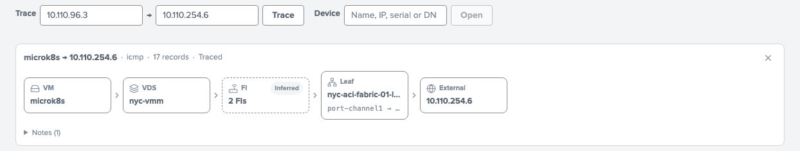

## 3. Blocked by an ACI contract

**What happened:** contract `atlas-deny-47003` (deny + log) was active 15:29:48–15:37:37. The ACL log shows drops 15:29:55–15:37:32.

- [During the deny, 15:29–15:38](https://<stack>.splunkcloud.com/en-US/app/splunk_adm/applications?trace_src=10.110.96.3&trace_dst=10.110.97.2&earliest=1793806140&latest=1793806680)
- [After the rollback, 15:47–15:55](https://<stack>.splunkcloud.com/en-US/app/splunk_adm/applications?trace_src=10.110.96.3&trace_dst=10.110.97.2&earliest=1793807220&latest=1793807700). No Blocked chip.

- Chips: **Blocked tcp/47003 (ACI contract)** and **tcp/47001 not blocked**. One port is denied while another forwards.
- The red leaf hop is where the drop was enforced.
- In the after-rollback link, old drop records are not re-counted.

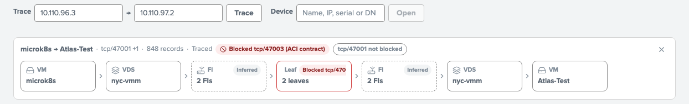

## 4. vPC member failover

**What happened:** leaf101 eth1/22 (po2, the vpc-1-22 member) was shut 15:38:43–15:46:19. Traffic moved to leaf102.

| | Trace 96.3 → 97.2 | leaf101 device page |
|---|---|---|
| Before (15:20–15:28) | [2 leaves](https://<stack>.splunkcloud.com/en-US/app/splunk_adm/applications?trace_src=10.110.96.3&trace_dst=10.110.97.2&earliest=1793805600&latest=1793806080) | [po2 rows present](https://<stack>.splunkcloud.com/en-US/app/splunk_adm/device?id=leaf101&earliest=1793805600&latest=1793806080) |
| During (15:39–15:46) | [leaf102 only](https://<stack>.splunkcloud.com/en-US/app/splunk_adm/applications?trace_src=10.110.96.3&trace_dst=10.110.97.2&earliest=1793806740&latest=1793807160) | [no po2 rows](https://<stack>.splunkcloud.com/en-US/app/splunk_adm/device?id=leaf101&earliest=1793806740&latest=1793807160) |
| After (15:47–15:55) | [2 leaves](https://<stack>.splunkcloud.com/en-US/app/splunk_adm/applications?trace_src=10.110.96.3&trace_dst=10.110.97.2&earliest=1793807220&latest=1793807700) | [po2 back](https://<stack>.splunkcloud.com/en-US/app/splunk_adm/device?id=leaf101&earliest=1793807220&latest=1793807700) |

- During the shut, the leaf hop narrows to **leaf102 port-channel1 → vpc-1-22-UCS-FI**.
- On the device page, type `po2` in **Filter**. You get about 114 rows before, **0 rows during**, and about 112 rows after.
- The lab saw no ping or tcp/47001 loss during the shut ([lab record](../operators/LIVE_SCENARIOS.md), row B).

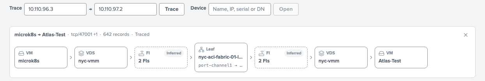
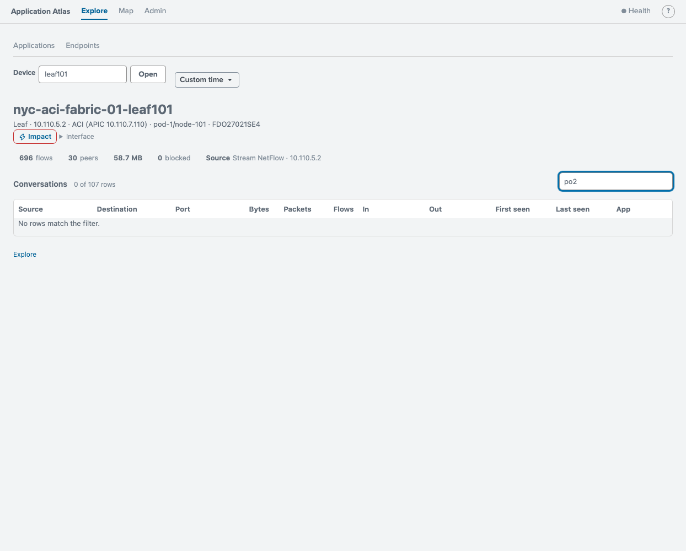

## 5. Pod reschedule

**What happened:** at 15:47 `teastore-recommender` was moved from appd-k8-5 (10.245.0.203) to appd-k8-1 (10.245.2.243). At 15:55 it moved back to appd-k8-5 (10.245.0.155). The webui pod is 10.245.0.159.

- [Before: same node, 15:40–15:47](https://<stack>.splunkcloud.com/en-US/app/splunk_adm/applications?trace_src=10.245.0.159&trace_dst=10.245.0.203&earliest=1793806800&latest=1793807220)
- [Moved to appd-k8-1, 15:48–15:54](https://<stack>.splunkcloud.com/en-US/app/splunk_adm/applications?trace_src=10.245.0.159&trace_dst=10.245.2.243&earliest=1793807280&latest=1793807640)
- [Back on appd-k8-5, 15:55–16:05](https://<stack>.splunkcloud.com/en-US/app/splunk_adm/applications?trace_src=10.245.0.159&trace_dst=10.245.0.155&earliest=1793807700&latest=1793808300)

- The pod name changes with each identity interval: `…-mz7ws` → `…-s2jkj` → `…-d2vx6`.
- Before the move the path is pod → **appd-k8-5** → pod, with 220 records. After the move it is appd-k8-5 → **+5 hops** → **appd-k8-1**.
- Between nodes, the hops are inferred (VXLAN). The new pod has no flow records in that window ("No records").

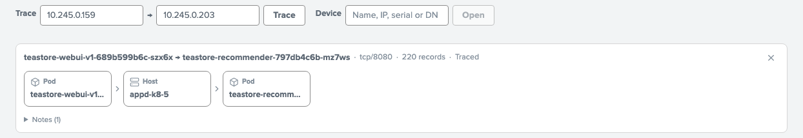
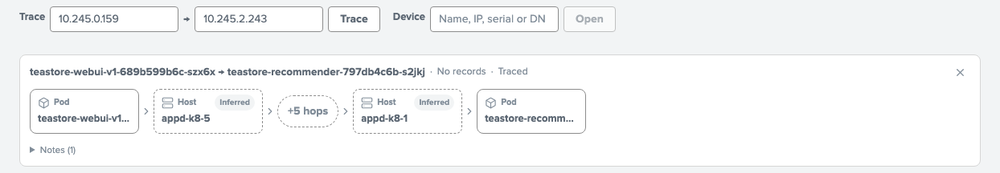

## 6. Everything through a device

- [leaf101, 15:20–15:28](https://<stack>.splunkcloud.com/en-US/app/splunk_adm/device?id=leaf101&earliest=1793805600&latest=1793806080)
- [ESXi 10.110.253.11, 15:20–15:28](https://<stack>.splunkcloud.com/en-US/app/splunk_adm/device?id=10.110.253.11&earliest=1793805600&latest=1793806080)

- Header: leaf101 is pod-1/node-101, with its serial and its APIC. Its flows come from the leaf's own NetFlow export.
- The **In / Out** columns name the port-channel and the vPC (leaf), or the vmnic uplink and VM vNIC port (ESXi).
- "Top 200 of N conversations" means the list is capped, and Atlas says so.

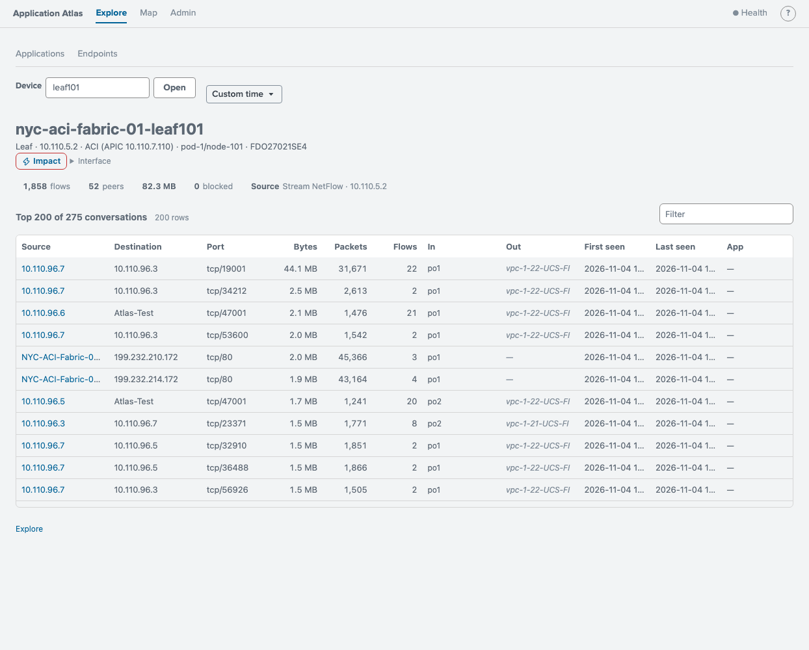
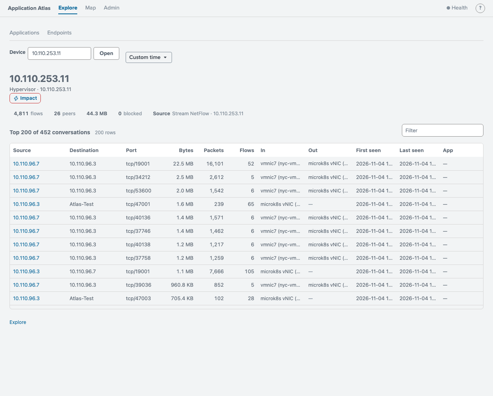

## 7. Impact: what breaks if this fails

All windows are 15:00–15:28.

- [leaf101](https://<stack>.splunkcloud.com/en-US/app/splunk_adm/impact?element=leaf101&mode=fails&earliest=1793804400&latest=1793806080). 0 outage, 8 apps degraded, traffic "shifts to leaf102".
- [FI-B (Cisco-Validated-NYC-DC-B)](https://<stack>.splunkcloud.com/en-US/app/splunk_adm/impact?element=Cisco-Validated-NYC-DC-B&mode=fails&earliest=1793804400&latest=1793806080). Degraded, traffic shifts to FI-A.
- [ESXi 10.110.253.14](https://<stack>.splunkcloud.com/en-US/app/splunk_adm/impact?element=10.110.253.14&mode=fails&earliest=1793804400&latest=1793806080). **6 apps Outage**, reason "host down", no alternate path.
- [What-if: leaf101 + leaf102](https://<stack>.splunkcloud.com/en-US/app/splunk_adm/impact?element=leaf101&element=leaf102&mode=fails&earliest=1793804400&latest=1793806080). Outage, reason "all redundant members down".

Point at the redundancy logic. One leaf or FI fails over and the apps are degraded. The host, or both leaves together, cause an outage. The blast map shows the affected workloads, hosts and network tiers.

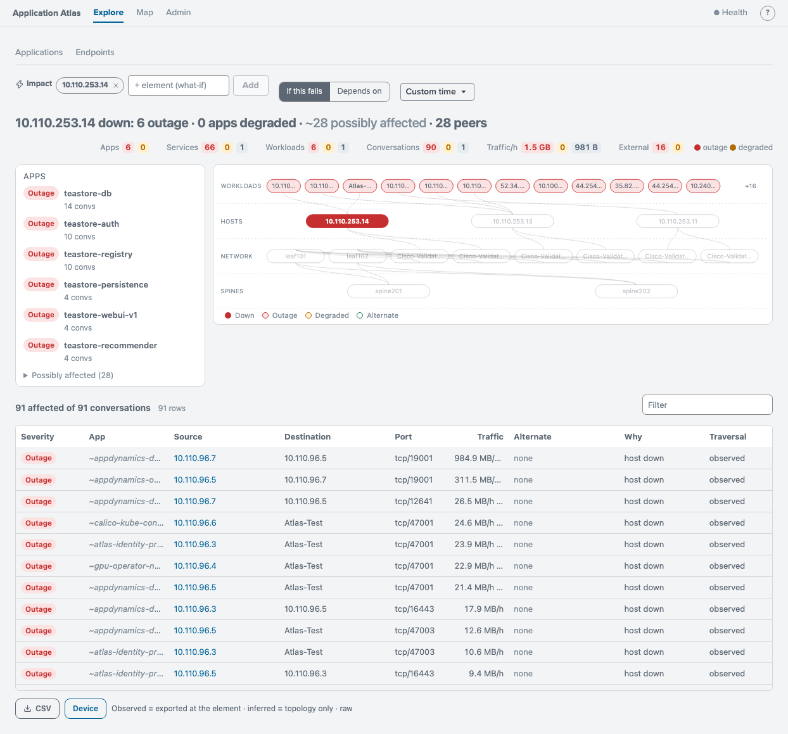
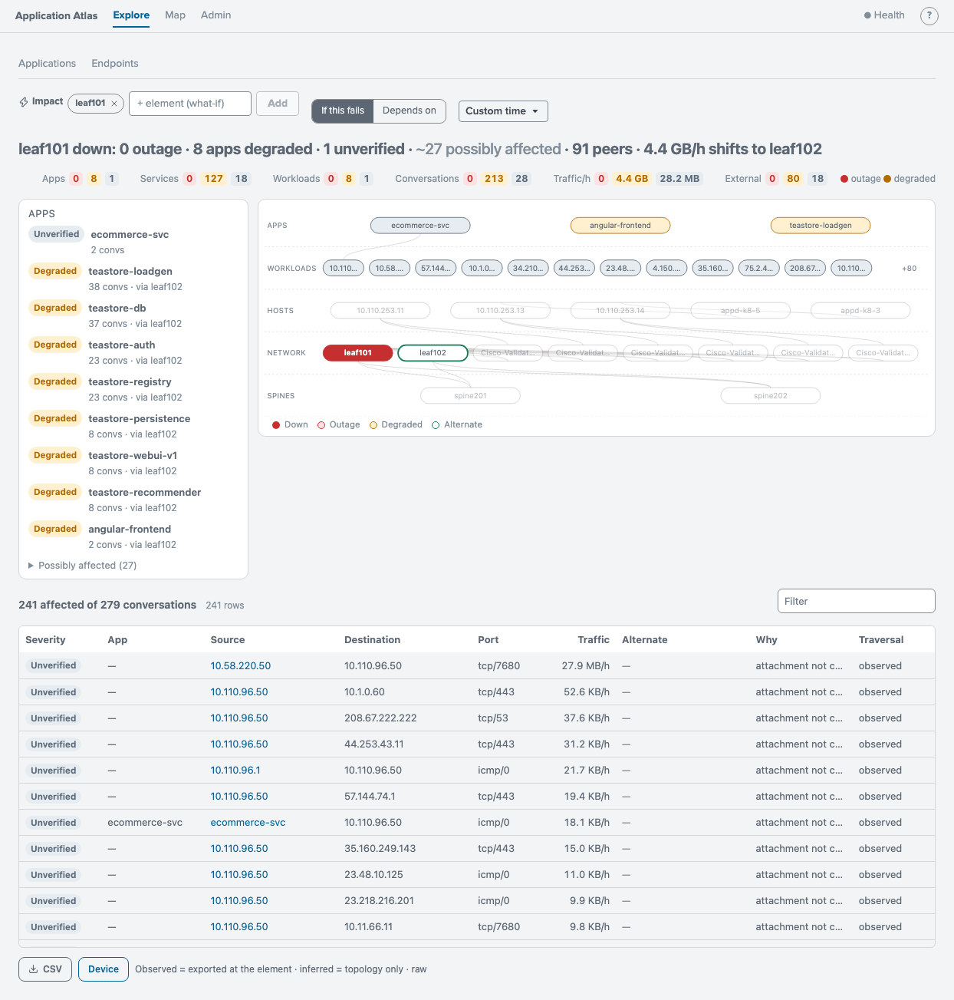
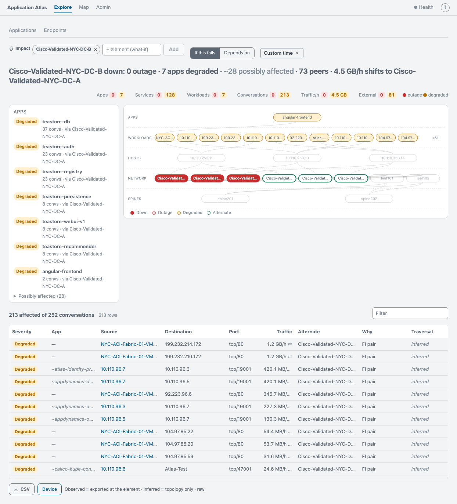
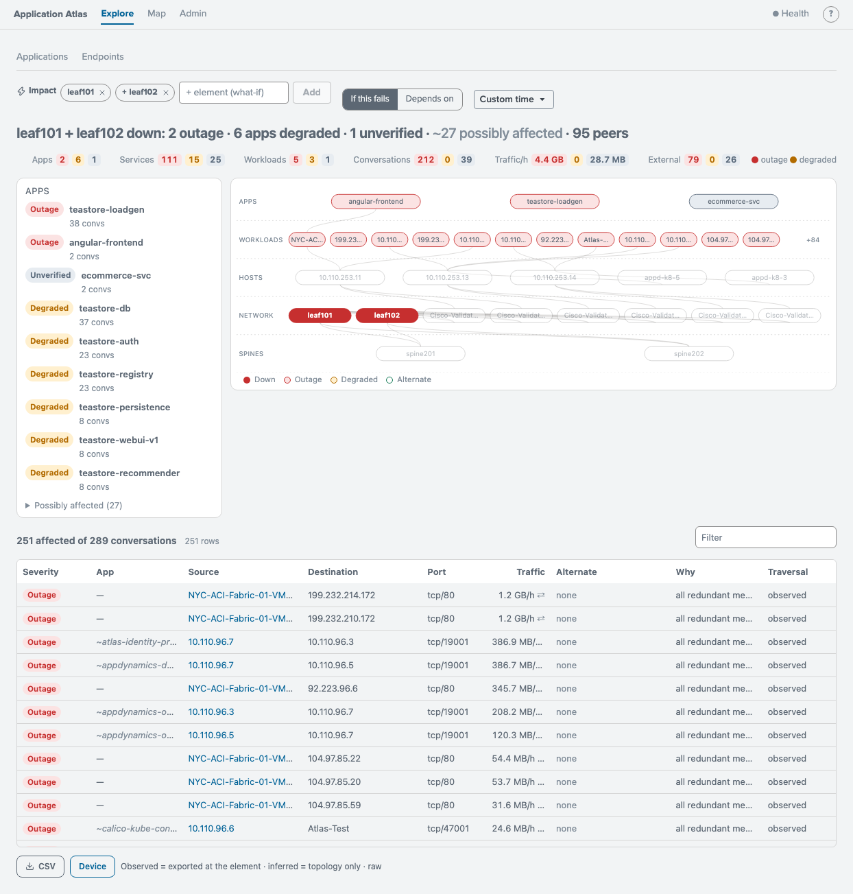

## 8. Application map

**What happened:** teastore-webui and its dependencies, built from five-minute summaries.

- [15 min, 15:15–15:30](https://<stack>.splunkcloud.com/en-US/app/splunk_adm/map?service=teastore-webui&environment=CV&cluster=K8-Fabrix-AI&namespace=teastore&earliest=1793805300&latest=1793806200&mode=live&tab=network)
- [24 h, 11-03 22:00 to 11-04 22:00](https://<stack>.splunkcloud.com/en-US/app/splunk_adm/map?service=teastore-webui&environment=CV&cluster=K8-Fabrix-AI&namespace=teastore&earliest=1793743200&latest=1793829600&mode=live&tab=network)

- The **Summarized** chip: hover it to see "Exact totals from five-minute summaries".
- The map runs from entry point → services → dependencies, including EPGs (Test-epg, CV-EPG-02) and external destinations.
- In the 24 h map, teastore-recommender shows **2 pods**, which is the reschedule from scenario 5.

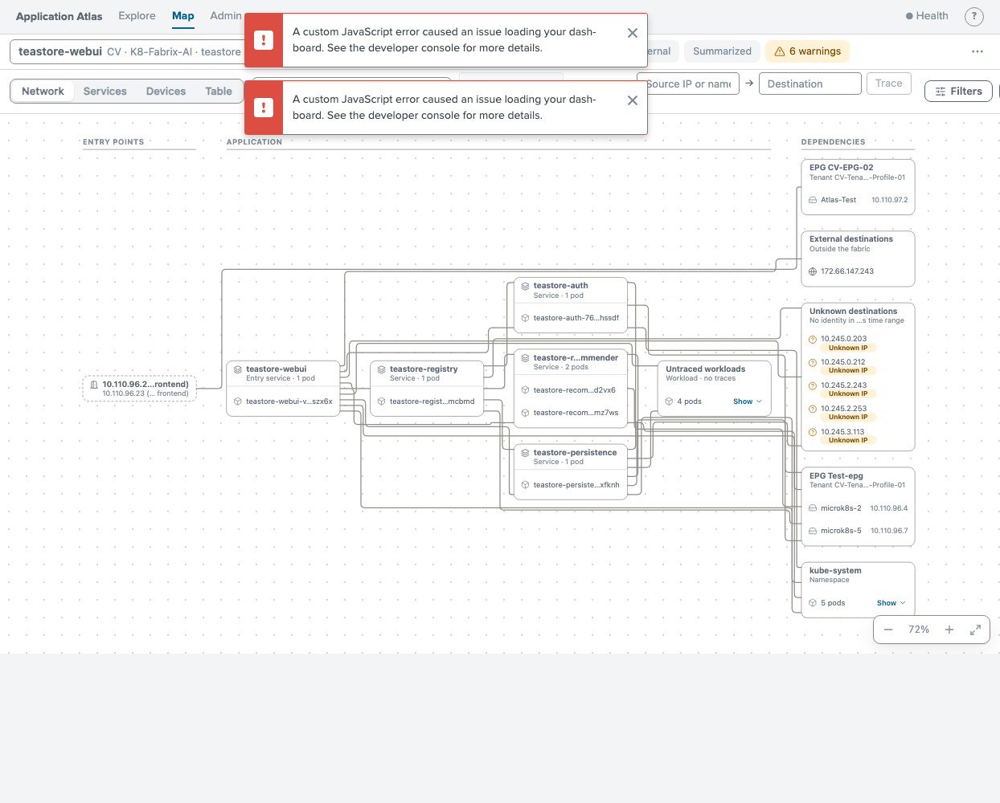

## 9. Collector outage (stale ACI inventory)

**What happened:** HF ACI class collection stopped from 06:05 to 14:08. NetFlow kept flowing.

- [Trace 96.3 → 97.2, 10:00–10:15](https://<stack>.splunkcloud.com/en-US/app/splunk_adm/applications?trace_src=10.110.96.3&trace_dst=10.110.97.2&earliest=1793786400&latest=1793787300)
- [leaf101, 10:00–10:15](https://<stack>.splunkcloud.com/en-US/app/splunk_adm/device?id=leaf101&earliest=1793786400&latest=1793787300)

- The trace reads **Partial · 1 gap**, "No attachment data for either side". Atlas does not draw a path it cannot support.
- leaf101 is **Not in inventory** for the window.
- Compare with scenario 1, a healthy window on the same pair.

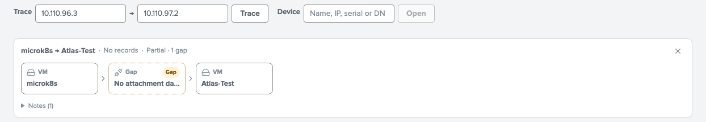

## 10. Same-host paths

- [Same host, same EPG: 96.4 ↔ 96.6 on ESXi .13](https://<stack>.splunkcloud.com/en-US/app/splunk_adm/applications?trace_src=10.110.96.4&trace_dst=10.110.96.6&earliest=1793805600&latest=1793806080). The path is VM → VDS → VM only.
- [Same host, different EPG: 96.5 ↔ 97.2 on ESXi .14](https://<stack>.splunkcloud.com/en-US/app/splunk_adm/applications?trace_src=10.110.96.5&trace_dst=10.110.97.2&earliest=1793805600&latest=1793806080). This one hairpins through the leaves, because it is routed between EPGs.
- [ESXi .14 device page](https://<stack>.splunkcloud.com/en-US/app/splunk_adm/device?id=10.110.253.14&earliest=1793805600&latest=1793806080). Filter `Atlas-Test`: In is `microk8s-3 vNIC, vmnic7 (uplink)` and Out is `Atlas-Test vNIC`. That is the hairpin.

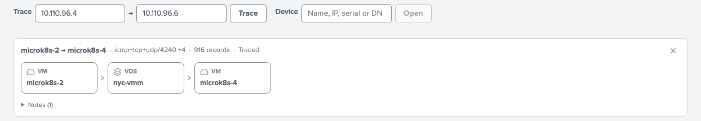
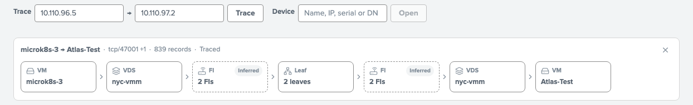

## 11. Impact: fail a vPC by name

**What happened:** nothing failed. This is a what-if on the vPC that scenario 4 shut one leg of. `vpc-1-22-UCS-FI` is po2 on leaf101 and po1 on leaf102 (member eth1/22 on both). It is FI-B's uplink pair. All windows are 15:00–15:28.

- [vpc-1-22-UCS-FI](https://<stack>.splunkcloud.com/en-US/app/splunk_adm/impact?element=vpc-1-22-UCS-FI&mode=fails&earliest=1793804400&latest=1793806080). **Degraded**, not Outage: 0 outage, 8 apps degraded, "shifts to Cisco-Validated-NYC-DC-A". FI-B loses both uplinks, and every host also has a vmnic to FI-A, whose vPC (vpc-1-21) is still up. `if:vpc-1-22-UCS-FI` gives the same result.
- [leaf101|po2](https://<stack>.splunkcloud.com/en-US/app/splunk_adm/impact?element=leaf101%7Cpo2&mode=fails&earliest=1793804400&latest=1793806080) and [leaf101|eth1/22](https://<stack>.splunkcloud.com/en-US/app/splunk_adm/impact?element=leaf101%7Ceth1/22&mode=fails&earliest=1793804400&latest=1793806080) take down one leg. Degraded, "shifts to leaf102 eth1/22". `leaf101|port-channel2` and `leaf101|vpc-1-22-UCS-FI` name the same port.
- [Both vPCs](https://<stack>.splunkcloud.com/en-US/app/splunk_adm/impact?element=vpc-1-22-UCS-FI&element=vpc-1-21-UCS-FI&mode=fails&earliest=1793804400&latest=1793806080). Both FIs lose the fabric: 2 apps Outage.

Port-channel membership (`pcAggrIf`/`pcRsMbrIfs`) was first collected at 17:55, after this window. Atlas takes membership from the next APIC snapshot and says so: "members from the APIC snapshot of 2026-11-04 17:55 UTC (none in this window)".

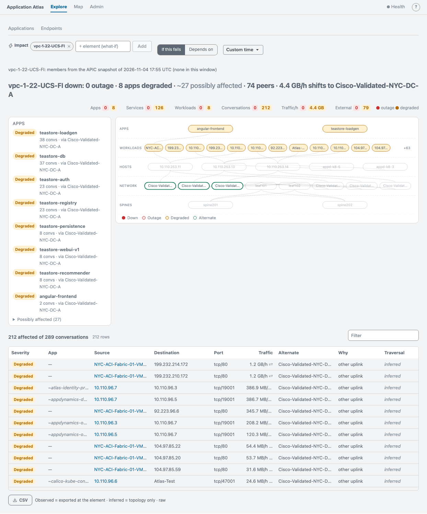

## 12. Data health during the collector outage

[Data health as of 14:00](https://<stack>.splunkcloud.com/en-US/app/splunk_adm/data_health?earliest=1793772000&latest=1793800800) (window 06:00–14:00, inside the scenario 9 gap).

- The header reads **As of 2026-11-04 14:00 UTC**. Receipt, scheduled runs, quality and graph summaries are judged at the window's end, not at the current time. Use the time picker to move the window.
- At 14:00 the newest indexed `cisco:dc:aci:class` record is from 06:00, about 8 h old. With ACI set **active** in Setup (5 min cadence, 20 min freshness), the ACI row reads **Expected receipt is overdue**.
- On this stack the source rows read **Staged; not expected to collect**. The saved expectations stage ACI, NetFlow, Kubernetes and Traces, and Setup cannot save changes on Splunk Cloud ([write gate](../DEPLOYMENT_HEALTH.md#supported-write-contract-and-deployment-gate)). No screenshot is included until expectations can be saved.

## Data retention

The links work as long as the data behind them is retained. Values were read from the index REST settings (`frozenTimePeriodInSecs`) on 2026-11-04:

| Index | Retention | Data from 2026-11-04 kept until at least |
|---|---|---|
| `netflow`, `cisco_aci`, `atlas_identity` | 90 days | 2027-02-02 |
| `adm_summary_v2` | 35 days | 2026-12-08 (the 24 h map starts 11-03), 2026-12-09 (all other maps) |

Scenario 8 (the maps) expires first. Traces, device pages and impact read raw data. Scenario 11's membership snapshot (17:55 onward) is in `cisco_aci`. Splunk freezes whole buckets, so data can stay searchable a little longer than this.

## Verification

All 28 distinct links above (31 checks) were opened again on 2026-11-04 in a logged-in headless browser against Atlas 0.8.5. Each one was checked for its key text in the DOM, and all **passed**. Screenshots are element captures of the Atlas root, without the Splunk header.
