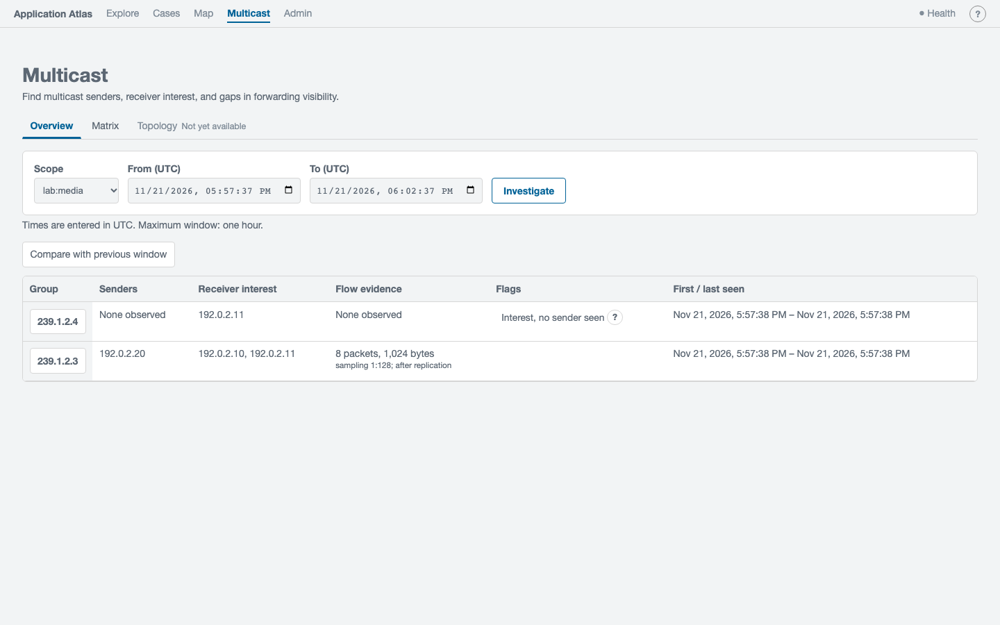
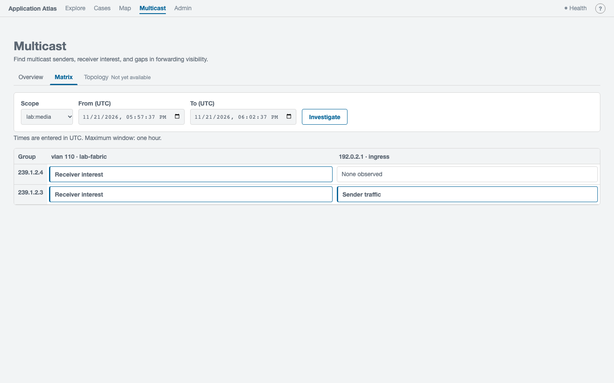

# Investigate IPv4 multicast

Open **Multicast** in Application Atlas or go to `/en-US/app/splunk_adm/multicast` on your search head. Select one verified routing scope and an absolute window of up to one hour, then select **Investigate**. Atlas lists the groups observed in that scope and window, and you can open any group to see its evidence. Copy the page URL to share the scope, window, view and any open group. The recipient runs the searches under their own Splunk session. Older links that name a group open that group's detail directly.

## Read the views

**Investigate** runs one bounded group summary search per active Stream IGMP and NetFlow profile in the scope. Overview and Matrix both use those results, so switching tabs does not search again. **Topology** is not yet available.

- **Overview** lists one row per observed group. It shows the senders seen in flow records, the receiver interest seen in IGMP reports, packet and byte totals with the profile's sampling and replication position, any flags, and when the group was first and last seen. Rows with more flags sort first.
- **Matrix** shows a grid with one row per group and one column per profile. IGMP columns are labelled by segment and NetFlow columns by exporter and direction. Each cell reads **Receiver interest**, **Sender traffic**, **None observed** or **Not covered**. **Not covered** means that profile's search did not complete, so its evidence for the group is unknown. Cells with evidence in the last five minutes of the window are styled differently from cells with only older evidence.
- **Group detail** opens when you select a group in Overview or a cell in Matrix. It runs the per-group investigation and shows the multicast tree, the evidence records, an IGMP timeline of reports, leaves and queries for each segment, and the observed query senders. Enter a sender to narrow the investigation. **Back to Overview** or **Back to Matrix** returns to the summary without searching again.

The summary counts each IGMPv3 group record under its own group. General IGMP queries (group `0.0.0.0`) count as query evidence for the capture. They clear **Leave without query** and contribute to **Multiple query senders**, but they never appear as a group row.

Each profile returns at most 256 groups. If a profile observes more, its coverage is partial and Overview reports how many groups are not shown for that profile. Atlas never drops groups silently.

### Flags

Flags describe what the evidence shows, not faults. Select **?** next to a flag in Overview to see its rule.

| Flag | Meaning |
| --- | --- |
| Interest, no sender seen | IGMP reports for this group were observed, but no flow summary in this scope showed sender traffic in this window. Uncovered paths or sampling can hide senders; it is an evidence gap, not a fault. |
| Sender, no interest seen | Flow records showed sender traffic for this group, but no IGMP capture in this scope observed receiver interest in this window. Receivers may sit beyond the captured segments; it is an evidence gap, not a fault. |
| New since previous window | This group was observed in this window but not in the previous window of equal length, which was searched completely. |
| Leave without query | A leave was observed with no later query from that capture in this window. It may be normal; it is an evidence gap, not a fault. |
| Multiple query senders | A capture covering this group observed IGMP queries from more than one source address in this window. It may be normal; it is an evidence gap, not a fault. |
| Source coverage partial | At least one stream source in this scope did not complete its search, so evidence for this group may be missing. |

### Compare with the previous window

**Compare with previous window** reruns the summary and also searches the window of equal length that ends where the selected window starts. It costs a second group summary search per profile, so it runs only when you select it. **New since previous window** appears only when every previous-window search completed. If profile validity does not cover the previous window, or a previous-window search does not complete, Overview shows "Comparison unavailable" with the reason and flags no group as new.

Editing the scope or window cancels a running search, and results from the earlier inputs are discarded.





## Qualify the capture and export

Qualify each feed with sanitized, genuine indexed events from the deployed version before enabling it. The bundled profiles and fixtures demonstrate candidate schemas. Record package and device releases, capture location, clock alignment, permitted index, scope mapping and tested field shapes in your deployment records. See [source qualification](../multicast-source-qualification.md) for current evidence gaps.

- **IGMP.** Use a capture point where the sensor and observed interface can be mapped to one routing scope and segment. Keep overlapping address spaces on separate capture interfaces or sensors. Validate local VLAN or VNI context against the actual capture, including tag stripping, mirror configuration and inner/outer VLAN handling. Verify that the indexed `host` identifies the sensor and that `network_interface` identifies the capture interface. The Stream reference stream disables `network_interface` by default. Verify `_time`, `src_ip`, `type` and `multicast_address` for IGMPv1/v2. For IGMPv3, verify `num_groups`, the ordered `group_record_multicast_address`, `group_record_type` and `group_record_num_sources` arrays, and the serialized `group_record_source_address` list. Compare a report with multiple groups and different source counts against its wire decode before attesting to `flat-counted`. Select `single-record` when only single-record messages have been verified.
- **Endpoint attribution.** Use `placement: "endpoint"` only when direct host reports can be validated. Attest each address in `endpointReporters` against that interface, segment and validity interval. Keep known proxy addresses in `proxyReporters`. Revalidate bindings after address reuse, VLAN changes or changes to proxying. Use `placement: "transit"` and an empty endpoint list for routed or proxy-facing captures. The tab retains query, proxy, anonymous and unverified reports as evidence. A join, leave or quiet capture does not establish current membership or delivery.
- **NetFlow/IPFIX.** Verify the actual multicast `src_ip`/`dest_ip` tuple, `exporter_ip`, `observation_domain_id`, `template_id`, `flow_dir` and interface identifiers emitted by one monitor. Confirm direction encoding with the indexed event (0 for ingress, 1 for egress). Establish whether exported `packets` and `bytes` are delta or total counters, the sampling interval (1 for unsampled), and the monitor position relative to replication. Retest after exporter or template changes. Counters are shown per observation with their declared meaning. Keep pre- and post-replication and different exporters separate.
- **Forwarding.** Atlas accepts a versioned, administrator-attested NX-OS IPv4 forwarding snapshot. Capture the same `(S,G)` route on the participating devices twice around the adjacency reads. Match outgoing and incoming interfaces, reciprocal CDP and PIM, and the downstream RPF neighbor. Keep route state in one VRF and distinguish VXLAN underlay from tenant traffic. A route through `nve1` may end at an unresolved overlay boundary.

## Enable profiles

An administrator maintains a single app-shared KV Store document in `adm_multicast_profiles` using the deployment's standard Splunk KV Store management workflow. The owner and app namespace are `nobody/splunk_adm`. The collection's REST resource is `/servicesNS/nobody/splunk_adm/storage/collections/data/adm_multicast_profiles`. Insert one document with `_key` set to `active` and `configuration` set to the JSON **string** of the versioned configuration. Update the existing keyed document to replace it; build and review the full replacement before submitting it. Review the effective shared collection ACL on each deployment. Viewer roles must already be authorized for the source indexes. Routing scopes separate attribution and confer no access.

Example decoded configuration for administrator review. The example addresses and times are synthetic.

```json
{
  "version": 1,
  "profiles": [
    {
      "id": "capture-east",
      "source": "multicast_igmp",
      "scope": "east:media",
      "index": "multicast",
      "observer": "sensor-east",
      "validFrom": 1795478400,
      "validUntil": 1796083200,
      "captureInterface": "eth0",
      "segment": {"kind": "vlan", "id": "110", "domain": "east-switching"},
      "placement": "endpoint",
      "endpointReporters": ["192.0.2.10"],
      "proxyReporters": ["192.0.2.1"],
      "v3Encoding": "flat-counted"
    },
    {
      "id": "netflow-east",
      "source": "multicast_netflow",
      "scope": "east:media",
      "index": "netflow",
      "observer": "192.0.2.1",
      "validFrom": 1795478400,
      "validUntil": 1796083200,
      "observationDomain": "8",
      "template": "256",
      "direction": "ingress",
      "samplingInterval": 128,
      "replication": "before",
      "counters": "delta"
    }
  ]
}
```

Use the narrowest index and one profile per overlapping source binding. Validity uses epoch seconds and must cover the entire requested window. Verify positive and negative cases with the intended viewer role. If Splunk returns no visible records, check the caller's permissions, time window and collection coverage before interpreting silence. The page searches on demand, shares Atlas's optional-search admission budget, and reports caps, blocked requests and incomplete searches. The search window and result caps limit work and result expansion. Search cost also depends on index volume and the deployment's role quotas.

## Replay an NX-OS forwarding snapshot

The source reads one complete, versioned JSON event from `atlas:nxos:multicast:v1` in the configured index. Use a dedicated input and index whose writers are trusted to publish verified forwarding cohorts. Set the HEC event `host` to the collector authority and the HEC event time to the cohort's `observedAt` epoch second. A profile chooses the exact authority, scope and historical range. Keep one forwarding profile per scope over any overlapping validity interval.

```json
{
  "id": "nxos-underlay",
  "source": "multicast_nxos",
  "scope": "lab:underlay",
  "index": "atlas_multicast",
  "observer": "atlas-nxos-snapshot",
  "validFrom": 1795478400,
  "validUntil": 1796083200
}
```

`tools/prepare_multicast_cohort.py` converts a protected, verified replay receipt to one HEC envelope. It checks the shared timestamp, route interfaces and the recorded reciprocal CDP, PIM and RPF matches. The tool writes the envelope to standard output. Run it offline with a private output file.

```sh
umask 077
python3 tools/prepare_multicast_cohort.py /protected/path/read-only-replay.json \
    --index atlas_multicast --host atlas-nxos-snapshot > forwarding-cohort.ndjson
```

After an operator approves deployment and indexing, submit the envelope through the dedicated input and enable the profile. In Atlas, select the scope, group and exact sender from the receipt. Set **To (UTC)** to the snapshot anchor and **From (UTC)** before it. A replay snapshot is valid only at its anchor. For a later time, the UI retains the record and marks its branches stale. Device snapshots establish forwarding state. They do not establish packet delivery, endpoint membership or a VNI-specific overlay path.

## Disable and roll back

Replace the active document with `{"version":1,"profiles":[]}` in its `configuration` string to disable multicast searches. Close or cancel open investigations and verify that reopening Multicast shows the setup state. Retain the previous profile document in your approved administrator records if you need to restore it. Confirm ordinary Atlas readiness, Map and Trace Path still operate. Restore profiles only after the app version, shared ACLs and source coverage have been qualified on every serving search head. Any capture or exporter rollback follows its own approved change process.
